# EatWithAi — Autonomous AI Restaurant Reservation & Hospitality Platform

[](https://python.org)
[](https://fastapi.tiangolo.com)
[](https://www.postgresql.org)
[](https://ai.google.dev)
[](https://react.dev)
[](https://tailwindcss.com)
[](tests/)
[](LICENSE)

An enterprise-grade, full-stack restaurant reservation engine and conversational AI concierge. Powered by **Google Gemini Function Calling**, **FastAPI Server-Sent Events (SSE)**, **PostgreSQL 14+**, and **React 18**, this system autonomously manages table allocations, table-joining combinations, dining duration rules, dietary menu inquiries, and real-time live occupancy synchronization — all protected by a **defense-in-depth prompt injection security matrix**.

---


---

## 📑 Table of Contents

1. [Executive Overview](#-executive-overview)
2. [Architectural Decisions & Trade-Offs ("The Why vs. Why Not")](#-architectural-decisions--trade-offs-the-why-vs-why-not)
3. [System Architecture & Data Flow](#-system-architecture--data-flow)
4. [Defense-in-Depth AI Security Matrix](#-defense-in-depth-ai-security-matrix)
5. [Relational Database & Yield Management Engine](#-relational-database--yield-management-engine)
6. [API Specifications & Streaming Protocol](#-api-specifications--streaming-protocol)
7. [Repository Structure](#-repository-structure)
8. [Testing & Quality Assurance](#-testing--quality-assurance)
9. [Quickstart & Operations Guide](#-quickstart--operations-guide)

---

## 🔭 Executive Overview

In the restaurant hospitality industry, reservation failures typically arise from two extremes:
1. **Rigid Rule-Based Form Systems**: Incapable of understanding nuanced guest requests ("*a quiet indoor booth for an anniversary dinner where one guest is celiac*").
2. **Naive Conversational Chatbots**: Prone to hallucinations, double-booking race conditions, SQL/prompt injection, and lack of deterministic relational validation.

**EatWithAi** resolves this friction by coupling a **relational source of truth (PostgreSQL)** with an **orchestrated LLM agent (Google Gemini)** equipped with typed function calling. Rather than granting the LLM free-form database access, the model operates against deterministic business-layer tools that validate operational constraints, check opening shifts and holiday closures, calculate dynamic party stay durations, and enforce explicit confirmation barriers before any state modification occurs.

### Core Metrics & Capabilities
- **Zero Hallucinated Writes**: Reservations can only be persisted after executing deterministic SQL availability checks and satisfying an explicit human-in-the-loop confirmation barrier.
- **Sub-Millisecond Guardrail Enforcement**: Heuristic injection pre-filtering executes in `< 1ms`, dropping malicious prompts before consuming LLM tokens.
- **Automated Table Yield Optimization**: Greedy minimization of unused seats (`seats_max ASC`) and dynamic multi-table combination graphs (`table_combinations`).
- **Real-Time Live Occupancy Telemetry**: Non-blocking `asyncio` background lifespan loop continuously synchronizes database table availability against active booking intervals.

---

## ⚖️ Architectural Decisions & Trade-Offs ("The Why vs. Why Not")

Every technical decision in EatWithAi was evaluated against production realities: latency, reliability, security, maintainability, and operational cost.

### 1. Database Layer: Raw PostgreSQL + `psycopg2` vs. Heavy ORMs (SQLAlchemy / Django ORM)

| Dimension | Chosen: Raw SQL + `psycopg2` + Views | Alternative: Heavy ORM (SQLAlchemy / Prisma) |
| :--- | :--- | :--- |
| **Why Chosen** | • **Zero abstraction penalty** for complex interval overlap logic (`start_time < %s AND end_time > %s`).<br>• Native access to PostgreSQL features: `STRING_AGG`, `EXTRACT(EPOCH)`, symmetric joins, partial indexes, and database triggers.<br>• Crystal-clear, auditable execution plans (`EXPLAIN ANALYZE`). | • High learning curve and abstraction overhead for complex table-joining self-joins.<br>• Tendency to generate inefficient N+1 query patterns when loading combinations and booking tables.<br>• Schema divergence between ORM models and database triggers. |
| **Trade-Off Accepted** | Writing explicit parameter-mapped SQL queries requires diligent discipline to avoid SQL injection (mitigated via parameterized queries `%s` everywhere). |
| **Why Not ORM?** | For reservation engines, booking conflicts and adjacent table combinations are fundamentally graph and interval problems. ORM query builders frequently obscure this relational algebra, producing bloated queries that are difficult to index and tune. |

---

### 2. LLM Orchestration: Native Gemini Function Calling vs. Heavy Agentic Frameworks (LangChain / CrewAI / AutoGPT)

| Dimension | Chosen: Native Gemini SDK + Typed Tools | Alternative: LangChain / CrewAI / LlamaIndex |
| :--- | :--- | :--- |
| **Why Chosen** | • **Predictable, zero-magic execution loop**: Full control over token dispatch and tool lifecycle.<br>• **Minimal dependency graph**: Eliminates thousands of transitive dependencies, vulnerability alerts, and rapid upstream deprecations.<br>• **Direct JSON schema enforcement**: Gemini receives standard JSON-Schema parameter definitions with deterministic types. | • Heavy, rapidly shifting abstractions that wrap simple API calls in layers of hidden callbacks and prompts.<br>• Complex, non-deterministic agent loop debugging.<br>• Significant latency overhead and opaque error surfaces. |
| **Trade-Off Accepted** | Orchestration loops, session pruning, and fallback handlers are maintained in-house (~280 LOC in `src/eatwithai/chatbot/agent.py`). |
| **Why Not Framework?** | Production systems require transparency. Using native SDKs guarantees deterministic tool routing, minimal cold-start times, and zero vendor lock-in to opinionated multi-agent frameworks. |

---

### 3. Safety Architecture: 4-Layer Defense-in-Depth vs. System-Prompt-Only Guardrails

| Dimension | Chosen: Multi-Layered Security Matrix | Alternative: System Prompt Directives Only |
| :--- | :--- | :--- |
| **Why Chosen** | • **Deterministic pre-filtering**: Regex heuristic engine catches direct instruction overrides (`"ignore instructions"`, `"DAN"`, `"developer mode"`) in `< 1ms` at $0 cost.<br>• **Boundary isolation**: Wraps input in `<untrusted_customer_message>` tags, training the model to treat input purely as text payload, not executable instructions.<br>• **State machine barrier**: Model is structurally barred from invoking write tools (`create_booking_reservation`) without explicit user consent.<br>• **Parameter validation**: Strict length, regex, and type sanitization at the function call boundary. | • Relies on the probabilistic compliance of the LLM.<br>• Vulnerable to jailbreak variations, roleplay escapes, and instruction hijacking.<br>• Burns expensive API tokens on malicious or adversarial prompts. |
| **Trade-Off Accepted** | Slightly higher application-layer codebase footprint (`src/eatwithai/security.py`). |
| **Why Not Prompt Only?** | LLMs are probabilistic text predictors, not security boundaries. Prompt-only defenses have repeatedly proven vulnerable to adversarial jailbreaks. Security must be enforced deterministically outside the LLM. |

---

### 4. Real-Time Transport: Server-Sent Events (SSE) vs. WebSockets vs. REST Polling

| Dimension | Chosen: Server-Sent Events (`POST /api/chat/stream`) | Alternative A: WebSockets (`ws://`) | Alternative B: REST Polling |
| :--- | :--- | :--- | :--- |
| **Why Chosen** | • **Unidirectional streaming**: AI token generation flows one way (server to client).<br>• **HTTP/2 multiplexing**: Operates over standard HTTPS ports with zero special firewall configuration.<br>• **Native browser reconnection**: Automatic retry semantics built into the web platform.<br>• **Stateless edge-friendly**: Easily passes through Nginx, Cloudflare, AWS ALB, and API gateways without maintaining sticky state. | • Unnecessary protocol handshake overhead for client request / stream-back patterns.<br>• Complex stateful socket reconnection and load balancing.<br>• Stateful socket connection pooling taxes server memory. | • High latency between token chunks.<br>• Severe request amplification and database load.<br>• Choppy, unappealing conversational user experience. |
| **Trade-Off Accepted** | SSE is unidirectional; subsequent customer messages are dispatched as distinct HTTP POST requests with a persistent `session_id`. |

---

### 5. Table Allocation & Duration: Relational Graph & Dynamic Rules vs. Fixed Time Slots

| Dimension | Chosen: Dynamic Relational Graph & Dining Rules | Alternative: Fixed 2-Hour Slot Blocks |
| :--- | :--- | :--- |
| **Why Chosen** | • **Maximizes restaurant yield**: Dynamic stay allocation (e.g. 75 mins for 2 guests; 120 mins for 6 guests) enables 25-40% higher table turnover.<br>• **Table Combinations**: Symmetric junction table `table_combinations` dynamically pairs adjacent tables (e.g., T01 + T02) for large parties without permanently merging tables in the schema.<br>• **Yield-optimized matching**: Sorting by `seats_max ASC` prevents seating a party of 2 at a 6-person booth. | • Rigid 2-hour blocks waste seating capacity during quick lunch shifts or small party dinners.<br>• Cannot handle odd party sizes or large group table joining without manual host intervention. |
| **Trade-Off Accepted** | Availability queries must execute interval conflict checks (`b.start_time < %s AND b.end_time > %s`) against both individual tables and candidate joined pairs. |

---

### 6. Background Synchronization: Lifespan Asyncio Daemon vs. External Worker (Celery/Redis)

| Dimension | Chosen: In-Process `asyncio` Lifespan Worker | Alternative: Celery + RabbitMQ / Redis |
| :--- | :--- | :--- |
| **Why Chosen** | • **Zero infrastructure baggage**: Runs directly within the FastAPI event loop during application lifespan.<br>• Automatically synchronizes PostgreSQL table occupancy states every 10 seconds.<br>• Perfect for single-instance, microservice, or containerized deployments. | • Requires provisioning, monitoring, and paying for Redis/RabbitMQ brokers and separate worker processes.<br>• Excessive complexity for a single periodic synchronization query. |
| **Scale Evolution Path** | The occupancy update logic is encapsulated in `eatwithai.db.repository.update_tables_occupancy()`. If scaling horizontally across multiple replicas, this task can be cleanly offloaded to a Redis-backed scheduler or Kubernetes CronJob in minutes without touching core business logic. |

---

## 🏗️ System Architecture & Data Flow

The following sequence illustrates how a user request traverses the security perimeter, LLM tool dispatcher, and relational database engine:

```mermaid
sequenceDiagram
    autonumber
    actor Guest as Customer / Web Client
    participant API as FastAPI Backend (server.py)
    participant Sec as Security Engine (security.py)
    participant Agent as Gemini Agent (agent.py)
    participant Tools as Tool Dispatcher (tools.py)
    participant DB as PostgreSQL Database

    Guest->>API: POST /api/chat/stream {message, session_id}
    
    rect rgb(30, 30, 45)
        Note over API,Sec: Layer 1: Deterministic Injection Pre-Filter
        API->>Sec: check_prompt_injection(message)
        alt Injection Pattern Detected
            Sec-->>API: Flagged (e.g. "ignore instructions")
            API-->>Guest: SSE Token Stream (Polite Refusal) & Terminate
        end
    end

    rect rgb(35, 40, 55)
        Note over API,Agent: Layer 2: Boundary Tagging & Grounding
        API->>Sec: wrap_user_message_with_boundary(message)
        Sec-->>Agent: <untrusted_customer_message>...</untrusted_customer_message>
        Agent->>Agent: Ground with Live System Time & Dining Rules
    end

    rect rgb(40, 50, 65)
        Note over Agent,DB: Layer 3: Function Calling & Relational Verification
        Agent->>Tools: check_table_availability(date, time, party_size)
        Tools->>DB: Check shift hours, closures & non-overlapping tables
        DB-->>Tools: Available Table Candidate (e.g., T01, Nebula Lounge)
        Tools-->>Agent: JSON-Safe Payload (serialize_for_json)
    end

    rect rgb(30, 45, 40)
        Note over Agent,Guest: Layer 4: Confirmation Barrier & Streaming
        Agent-->>API: SSE Stream: "Table available. Please confirm: Name, Phone, 19:30?"
        API-->>Guest: Real-Time SSE Token Stream
    end

    opt Customer Explicitly Confirms
        Guest->>API: POST /api/chat/stream "Yes, please confirm for Alex Smith"
        API->>Agent: Dispatched
        Agent->>Tools: create_booking_reservation(customer, date, time, party)
        Tools->>DB: INSERT customer + INSERT booking + INSERT booking_tables
        DB-->>Tools: booking_id (UUID v4)
        Tools-->>Agent: Confirmation Success
        Agent-->>Guest: SSE Stream: "Confirmed! Booking Reference: #UUID"
    end
```



---

## 🛡️ Defense-in-Depth AI Security Matrix

Prompt injection represents the OWASP Top 10 #1 vulnerability for LLM applications. EatWithAi implements a defense-in-depth architecture:

| Defense Layer | Implementation | Mechanism | Threat Neutralized | Latency / Cost Overhead |
| :--- | :--- | :--- | :--- | :--- |
| **Layer 1: Pre-Filter** | `check_prompt_injection()` in `security.py` | Compiled regex pattern matching against direct overrides, roleplay escapes (`DAN`, `developer mode`), system prompt probes, and SQL DDL. | Direct instruction hijacking, system prompt extraction, hostile probing. | **< 1ms**, 0 API tokens consumed. |
| **Layer 2: Structural Delimitation** | `wrap_user_message_with_boundary()` | Encloses input in `<untrusted_customer_message>` XML tags. | Context-switching attacks, indirect injection payloads. | Negligible string concatenation overhead. |
| **Layer 3: Confirmation Barrier** | System Prompts & Agent Protocol in `prompts.py` | LLM is structurally instructed and strictly forbidden from calling state-modifying tools (`create_booking_reservation`) without explicit summary and confirmation. | Unauthorized database writes, hallucinated reservations, social engineering. | None (enforced via agent state machine). |
| **Layer 4: Parameter Sanitization** | `validate_booking_data()` | Application-level validation: phone number digit counting, name length constraints (1-50 chars), party size limits (1-30), and special request payload checks. | Malformed database entries, buffer overflow, secondary injection into storage. | Sub-millisecond CPU execution. |
| **Serialization Guardrail** | `@json_safe_tool` decorator in `tools.py` | Recursively converts `UUID`, `Decimal`, `datetime`, `date`, and `time` into standard JSON primitives. | Prevents LLM SDK crashes (`Object of type Decimal is not JSON serializable`). | Zero runtime penalty on valid types. |

---

## 🗄️ Relational Database & Yield Management Engine

The database is built on **PostgreSQL 14+**, utilizing relational integrity, check constraints, foreign keys, and indexes.

### Entity Relationship Model

```text
[ customers ] (UUID PK)
      │
      │ 1:N
      ▼
[ bookings ] (UUID PK) ──1:N──▶ [ booking_tables ] (Composite PK)
      │                                │
      │                                │ N:1
      │                                ▼
      │                         [ tables ] (SERIAL PK)
      │                                │
      │                                │ 1:N
      │                                ▼
      │                    [ table_combinations ] (Symmetric Composite PK)
      ▼
[ dining_rules ] (Party size ──▶ Allocated stay duration)

[ opening_shifts ] & [ closures ] (Shift cutoffs & holiday exceptions)

[ menu_categories ] ──1:N──▶ [ menu_items ] (Allergens, dietary flags, price)
```

### Table Definitions & Constraints

| Table | Primary Key | Critical Constraints & Notes |
| :--- | :--- | :--- |
| **`customers`** | `UUID` (`gen_random_uuid()`) | `email` (UNIQUE), `phone` (`VARCHAR(50)`), `name`, `surname`, `created_at` (`TIMESTAMPTZ`). |
| **`tables`** | `SERIAL` (`table_id`) | `name` (UNIQUE, e.g. `'T01'`), `seats_min > 0`, `seats_max >= seats_min`, `area` IN (`'indoor'`, `'terrace'`, `'bar'`, `'private_room'`), `available` (`BOOLEAN`). |
| **`table_combinations`** | `(table_id, combinable_with_table_id)` | Normalized junction table for adjacent combinable tables. Enforces `CHECK (table_id <> combinable_with_table_id)` and cascade deletes. |
| **`opening_shifts`** | `SERIAL` (`shift_id`) | `weekday` (0=Monday...6=Sunday), `start_time`, `end_time`, `last_bookable_time` (enforces order cutoffs). |
| **`closures`** | `SERIAL` (`closure_id`) | `date` (`DATE`), `shift_id` (NULL = full day closure), `reason` (`VARCHAR(255)`). |
| **`dining_rules`** | `SERIAL` (`rule_id`) | `party_size_from`, `party_size_to`, `duration_minutes`. Defines dynamic length-of-stay. |
| **`bookings`** | `UUID` (`gen_random_uuid()`) | `customer_id` (FK), `start_time`, `end_time`, `CHECK (end_time > start_time)`, `status` IN (`'pending'`, `'confirmed'`, `'cancelled'`, `'arrived'`, `'no_show'`), `source` IN (`'chatbot'`, `'phone'`, `'staff'`, `'website'`). |
| **`booking_tables`** | `(booking_id, table_id)` | Maps reservations to one or multiple tables with foreign key delete cascades. |
| **`menu_categories`** | `SERIAL` (`category_id`) | `name` (UNIQUE), `display_order` (`INTEGER`). |
| **`menu_items`** | `SERIAL` (`item_id`) | `category_id` (FK), `price >= 0`, `spicy_level` (0-3), `is_vegetarian`, `is_vegan`, `is_gluten_free`, `allergens`. |

### Performance Indexing Strategy
To ensure sub-10ms response times on booking lookups under load, dedicated multi-column and partial indexes are configured:
- `idx_bookings_start_end` ON `bookings(start_time, end_time)` — Accelerates interval overlap scans.
- `idx_booking_tables_table` ON `booking_tables(table_id)` — Rapid join resolution for occupied tables.
- `idx_tables_area` ON `tables(area)` & `idx_tables_active` ON `tables(active)` — Instant zone filtering.
- `idx_menu_items_dietary` ON `menu_items(is_vegetarian, is_vegan, is_gluten_free)` — Immediate dietary preference lookup.

### Database Views
- **`v_tables_with_combinations`**: Employs `STRING_AGG(c.name, ', ' ORDER BY c.name)` to present an aggregated view of table combination capabilities.
- **`v_booking_details`**: Comprehensive reporting view calculating stay duration via `ROUND(EXTRACT(EPOCH FROM (b.end_time - b.start_time)) / 60)` and aggregating assigned table names.
- **`v_menu_details`**: Denormalized view joining items to categories, sorted by category display order.

---

## ⚡ API Specifications & Streaming Protocol

FastAPI exposes both real-time SSE streaming for the conversational agent and standard REST endpoints for the web UI:

| Endpoint | Method | Description | Payload / Response |
| :--- | :--- | :--- | :--- |
| **`/api/chat/stream`** | `POST` | Real-time Server-Sent Events (SSE) AI concierge stream. | `{"session_id": "uuid", "message": "string"}` |
| **`/api/tables`** | `GET` | Live occupancy and availability status of all restaurant tables. | Returns JSON array of tables with active booking details. |
| **`/api/tables/sync-occupancy`**| `POST` | Forces immediate database re-calculation of table occupancy. | Synchronous occupancy reconciliation response. |
| **`/api/check-availability`** | `POST` | Verifies table availability for given date, time, and party size. | `{"date": "2026-10-20", "time": "19:30", "party_size": 4}` |
| **`/api/reserve`** | `POST` | Direct reservation booking (for web booking wizard). | `{"customer_name": "...", "phone": "...", "date": "...", ...}` |
| **`/api/cancel-booking`** | `POST` | Verified reservation cancellation. | `{"booking_id": "...", "verification_phone_or_email": "..."}` |
| **`/api/menu`** | `GET` | Returns full restaurant menu with optional category/dietary filters.| `?category=burgers&dietary=gluten_free` |
| **`/api/restaurant-info`** | `GET` | Returns operating hours, shifts, upcoming closures, and zone layouts. | Operational telemetry JSON. |
| **`/api/health`** | `GET` | Backend health check and Gemini model metadata. | `{"status": "online", "gemini_model": "..."}` |

### SSE Stream Wire Format
The `/api/chat/stream` endpoint dispatches typed SSE events:
```http
HTTP/1.1 200 OK
Content-Type: text/event-stream
Cache-Control: no-cache
Connection: keep-alive
X-Accel-Buffering: no

event: guardrails
data: {"injection_detected": false, "reason": null}

event: token
data: {"chunk": "Welcome "}

event: token
data: {"chunk": "to "}

event: token
data: {"chunk": "EatWithAi. "}

event: done
data: {"done": true}
```

---

## 📁 Repository Structure

The codebase is organized following modern Python packaging standards (PEP 518/621 `src` layout) and clean architecture separation:

```text
EatWithAi/
├── .env.example             # Environment variable template
├── pyproject.toml           # PEP 518/621 build configuration & CLI entry points
├── requirements.txt         # Core dependencies
├── README.md                # Engineering documentation
│
├── sql/                     # PostgreSQL Relational Engine
│   ├── schema.sql           # DDL: tables, indexes, triggers, constraints, views
│   └── seed_data.sql        # Canonical seed dataset with synchronized sequences
│
├── src/eatwithai/           # Main Python Package (src layout)
│   ├── __init__.py          # Package exports & versioning
│   ├── config.py            # Centralized environment configuration
│   ├── models.py            # Strongly-typed domain dataclasses
│   ├── security.py          # 4-stage prompt injection & sanitization engine
│   ├── server.py            # FastAPI backend (SSE streaming & REST routes)
│   ├── cli.py               # Unified management CLI
│   │
│   ├── db/                  # Data Persistence Layer (Repository Pattern)
│   │   ├── __init__.py      # Facade exports
│   │   ├── connection.py    # PostgreSQL connection context manager & pooling
│   │   └── repository.py    # Parameterized SQL queries, availability math, CRUD
│   │
│   └── chatbot/             # AI Agent & Orchestration Layer
│       ├── __init__.py      # Chatbot facade exports
│       ├── agent.py         # GeminiRestaurantChatbot session manager & streaming
│       ├── prompts.py       # Dynamically grounded system prompt generator
│       ├── tools.py         # 11 typed tool implementations (@json_safe_tool)
│       └── schemas.py       # JSON-Schema tool definitions for function calling
│
├── frontend/                # React 18 + Vite + Tailwind CSS Web Client
│   ├── src/                 # Modular React components (Chatbot, Menu, Zones, Hero)
│   ├── public/assets/       # Curated imagery matching database seed items
│   ├── tailwind.config.js   # Cosmos theme token definitions
│   └── dist/                # Pre-built production SPA bundle (served by FastAPI)
│
├── scripts/                 # Standalone Operational Runners
│   ├── init_db.py           # Database schema runner & verification script
│   ├── monitor_tables.py    # Real-time table occupancy CLI monitor daemon
│   ├── run_chatbot.py       # Terminal CLI interactive chatbot runner
│   └── run_server.py        # Production server runner (FastAPI + Uvicorn)
│
└── tests/                   # Automated Test Suite (31 Tests)
    ├── test_config.py       # Environment & path configuration tests
    ├── test_models.py       # Domain dataclass typing & instantiation tests
    ├── test_security.py     # Prompt injection regex & sanitization tests
    ├── test_tools.py        # Tool formatting & JSON serialization tests
    ├── test_db.py           # PostgreSQL relational queries & CRUD tests
    └── test_occupancy.py    # Real-time table occupancy & cancellation tests
```

---

## 🧪 Testing & Quality Assurance

The platform is fortified with **31 automated tests** covering unit, security, and database integration workflows.

### Test Suite Breakdown

| Test Module | Focus Area | Key Verifications |
| :--- | :--- | :--- |
| **`test_security.py`** | AI Safety & Guardrails | • Rejection of instruction overrides (`"ignore previous instructions"`).<br>• Neutralization of jailbreaks (`"act as DAN"`, `"developer mode"`).<br>• Blocking of system prompt leakage attempts.<br>• Input sanitization, control character stripping, and length limits. |
| **`test_tools.py`** | LLM Tooling & Serialization | • `@json_safe_tool` serialization of `UUID`, `Decimal`, `datetime`, `date`, `time`.<br>• Accurate stay duration calculation by party size.<br>• Correct time formatting and schedule lookups. |
| **`test_db.py`** | Relational CRUD & Integrity | • Customer insertion with UUID generation.<br>• Booking creation with table junction links.<br>• Menu querying with dietary and budget filters. |
| **`test_occupancy.py`** | Concurrency & State Sync | • Table `available` column updates based on active bookings.<br>• Inactive table exclusion logic.<br>• Booking cancellation and table release verification. |
| **`test_models.py`** | Domain Models | • Python dataclass instantiation, field defaults, and type safety. |
| **`test_config.py`** | Environment & Paths | • Validates `.env` discovery, default configurations, and schema file paths. |

### Running the Test Suite
```bash
# Run complete test suite with pytest
pytest -v

# Or run using standard Python unittest
PYTHONPATH=src python3 -m unittest discover -s tests -p "test_*.py"
```

---

## 🚀 Quickstart & Operations Guide

### Prerequisites
- **Python**: `3.10` or higher
- **PostgreSQL**: `13+` (with `uuid-ossp` or `pgcrypto`)
- **Google Gemini API Key**: Obtainable at [Google AI Studio](https://aistudio.google.com/)

---

### Step 1: Clone & Configure Environment

```bash
git clone https://github.com/your-username/EatWithAi.git
cd EatWithAi

# Create virtual environment
python3 -m venv venv
source venv/bin/activate

# Install dependencies
pip install -r requirements.txt
pip install -e .
```

Create your `.env` file in the root directory:
```env
# PostgreSQL Database Credentials
DB_HOST=localhost
DB_PORT=5432
DB_NAME=Restaurant
DB_USER=postgres
DB_PASSWORD=your_postgres_password
DB_SSLMODE=prefer

# Gemini AI Configuration
GEMINI_API_KEY=AIzaSy...your_gemini_key
GEMINI_MODEL=gemini-3.1-flash-lite
```

---

### Step 2: Initialize & Seed Database

Execute the automated database initializer to create tables, constraints, triggers, views, and seed data:
```bash
python3 scripts/init_db.py
# Or via CLI
python3 -m eatwithai init-db
```

---

### Step 3: Launch Web Application & API Server

Start the FastAPI application. The pre-built React production bundle is mounted and served automatically:
```bash
python3 scripts/run_server.py
```
- 🌐 **Web Interface**: [http://localhost:8000](http://localhost:8000)
- 📚 **Interactive Swagger API Docs**: [http://localhost:8000/docs](http://localhost:8000/docs)
- 📖 **ReDoc Documentation**: [http://localhost:8000/redoc](http://localhost:8000/redoc)

---

### Step 4: Alternative Operational Modes

#### A. Interactive Terminal AI Host (CLI Mode)
Test the conversational agent and prompt injection defenses directly in your terminal:
```bash
python3 scripts/run_chatbot.py
# Or via CLI
python3 -m eatwithai chat
```

#### B. Real-Time Table Occupancy Monitor Daemon
Run a continuous terminal monitor tracking table availability and active reservations:
```bash
python3 scripts/monitor_tables.py --interval 5
```

#### C. System Health & Database Diagnostics
```bash
python3 -m eatwithai status
```

#### D. Frontend Development (HMR Mode)
If modifying React/Tailwind frontend components with hot-module replacement:
```bash
cd frontend
npm install
npm run dev
# Vite runs at http://localhost:5173 and automatically proxies /api to :8000
```

---

## 👨‍💻 Engineering Competencies Demonstrated

This project showcases full-stack and systems engineering proficiencies:
- **Distributed LLM Engineering**: Function calling orchestration, dynamic temporal grounding, streaming token responses, and resilient SDK fallback patterns.
- **Relational Systems & SQL Architecture**: Advanced query optimization, symmetric junction graphs, epoch duration calculations, trigger-based updates, and view abstractions.
- **Application Security**: Defense-in-depth prompt injection mitigation, boundary isolation, deterministic pre-filtering, and sanitized parameter boundaries.
- **API Design & Concurrency**: Non-blocking `asyncio` lifespan daemons, Server-Sent Events (SSE) streaming protocols, and clean separation of concerns.
- **Automated Testing & Code Quality**: 100% test pass rate with integration, security, and unit coverage.

---

## 📄 License
This project is open-source under the [MIT License](LICENSE).
